# IndustrialVision AI

<p align="left">
  
  
  
  
  
  
</p>

**IndustrialVision AI** is a computer-vision-based visual inspection platform for manufacturing and quality control environments. The system integrates image testing, AI model management, operator workflows, and evidence logging to support decision-making on the production floor.

> **Production Readiness Note:** This repository provides a modular software foundation that has passed local integration tests and API contract validation. Real deployment on a live production floor still requires environment-specific validation, governance, and operational monitoring.

---

## Table of Contents

1. [Screenshots](#screenshots)
2. [Core Features](#core-features)
3. [System Architecture](#system-architecture)
4. [Technology Stack](#technology-stack)
5. [System Requirements](#system-requirements)
6. [Application Startup Guide (Local Development)](#application-startup-guide-local-development)
   - [1. Clone & Install Dependencies](#1-clone--install-dependencies)
   - [2. Environment Configuration](#2-environment-configuration)
   - [3. Database Migration & Admin Bootstrap](#3-database-migration--admin-bootstrap)
   - [4. Running the Backend API](#4-running-the-backend-api)
   - [5. Running the Frontend Console](#5-running-the-frontend-console)
7. [Operational Workflow](#operational-workflow)
8. [Project Structure](#project-structure)
9. [REST & WebSocket API Reference](#rest--websocket-api-reference)
10. [Environment Variables](#environment-variables)
11. [Testing & Quality Verification](#testing--quality-verification)
12. [Docker Compose Deployment](#docker-compose-deployment)
    - [Startup behaviour](#startup-behaviour)
    - [Backup & Restore](#backup--restore)
13. [Troubleshooting](#troubleshooting)
14. [Security & System Limitations](#security--system-limitations)
15. [User Guide (Panduan Lengkap)](#user-guide-panduan-lengkap)
16. [License & Contribution](#license--contribution)

---

## Screenshots

Captured from the running application with the bundled demo dataset
(`python -m app.seed`). The console ships in Bahasa Indonesia; all API
contracts are language-neutral.

> To regenerate after UI changes: seed a dev database, run the backend on
> `:8001` and `npm run dev` with `VITE_PROXY_TARGET=http://127.0.0.1:8001`,
> then execute `node e2e/screenshots.mjs` from `frontend/`.

### Operations overview

Live quality index, station fleet status, and the real-time inspection feed
delivered over WebSocket.

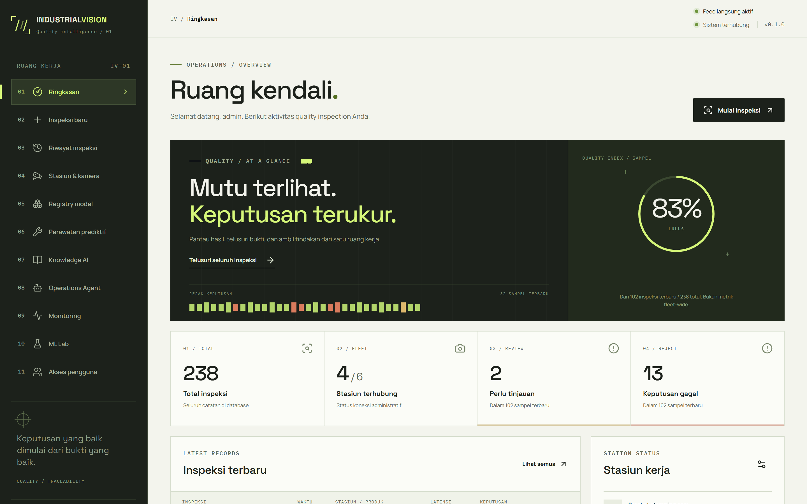

### Inspection workflow

| Quality inspection history | Inspection detail with evidence |
|---|---|
| 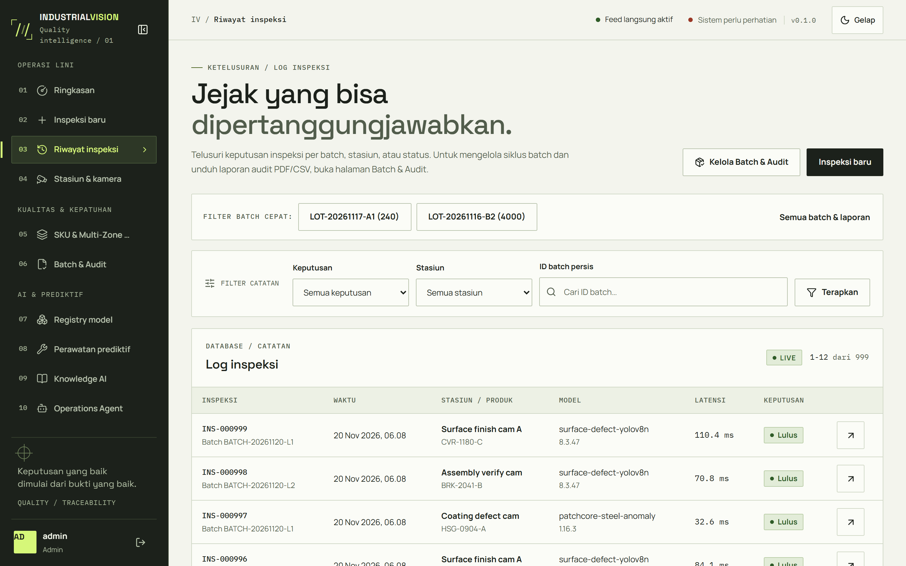 | 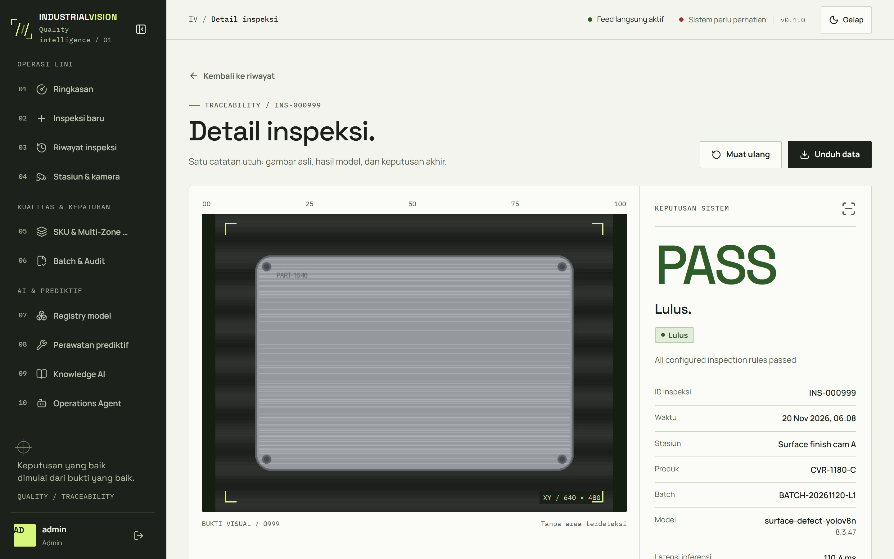 |

Upload a product image on the **new inspection** page — decisions (`PASS`,
`FAIL`, `REVIEW`, `ERROR`) always carry their rationale:

| New inspection | Login (role-aware console) |
|---|---|
| 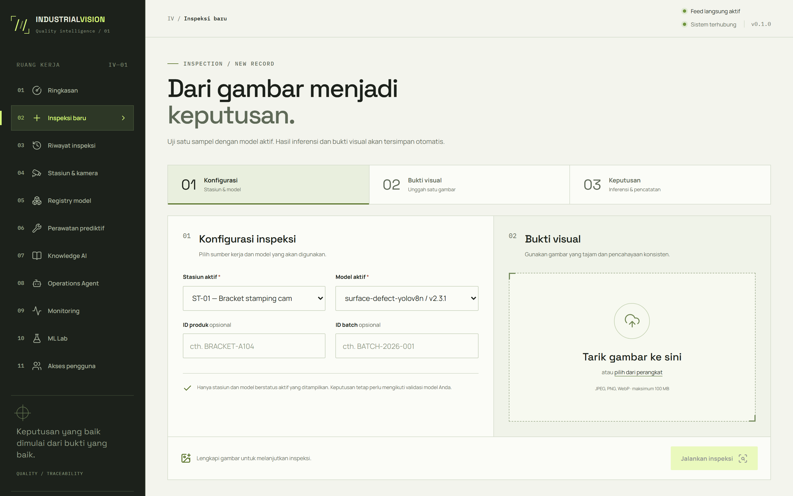 | 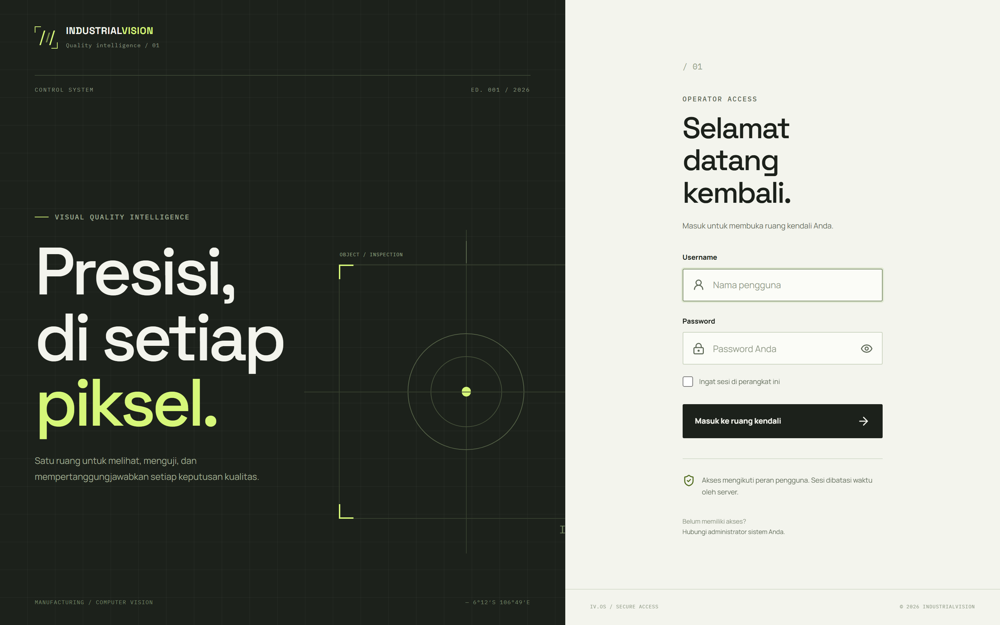 |

### Stations & model registry

| Camera / station fleet | Model registry with checksums & stages |
|---|---|
| 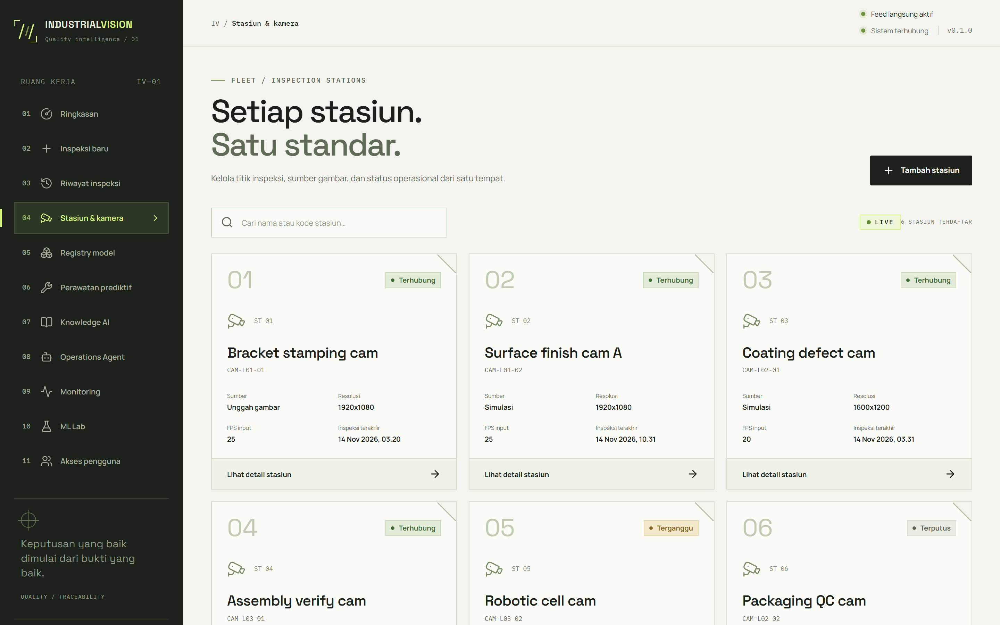 | 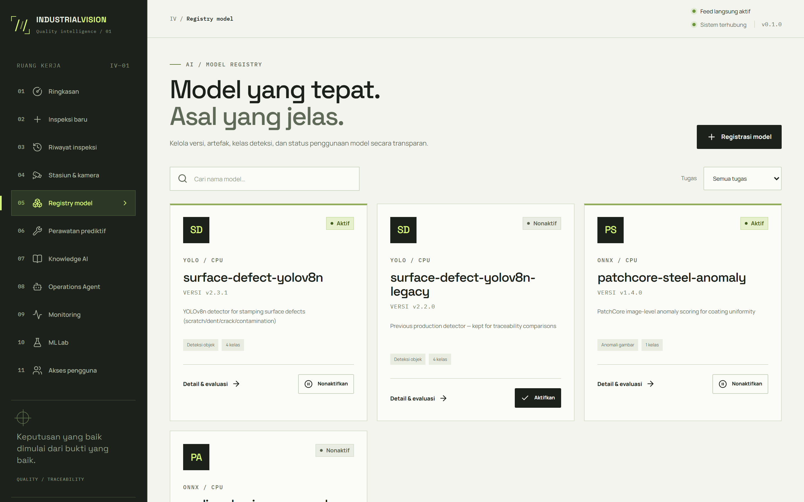 |

### Predictive maintenance

Machines with sensor-based health (AI4I 2020 schema), a fail-safe prediction
modal (`model` / `rules-only-fallback` / `error` modes are shown honestly),
and a human-approved maintenance queue:

| Machine fleet & approval queue | Fail-safe prediction modal |
|---|---|
| 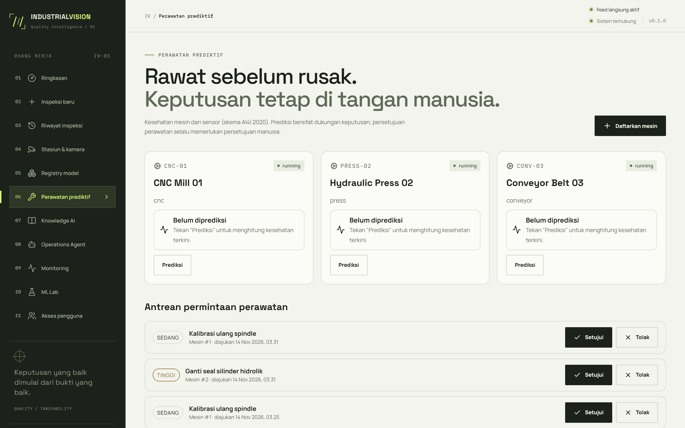 | 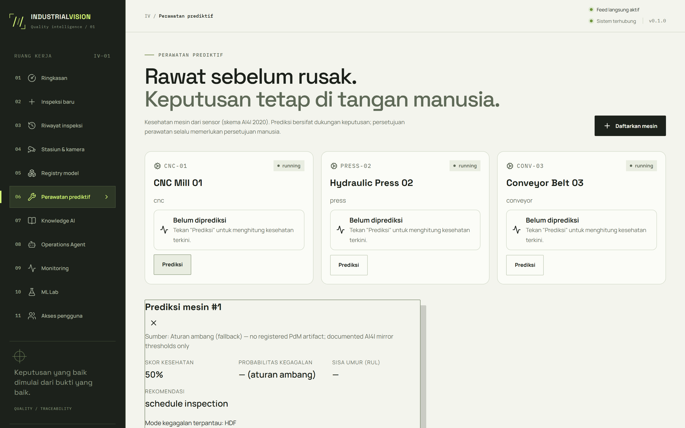 |

### Knowledge AI & Operations Agent

Grounded answers cite their source chunks; the agent plans with bounded tools
and asks for human approval before side effects:

| Knowledge AI chat with citations | Operations Agent with tool logs |
|---|---|
| 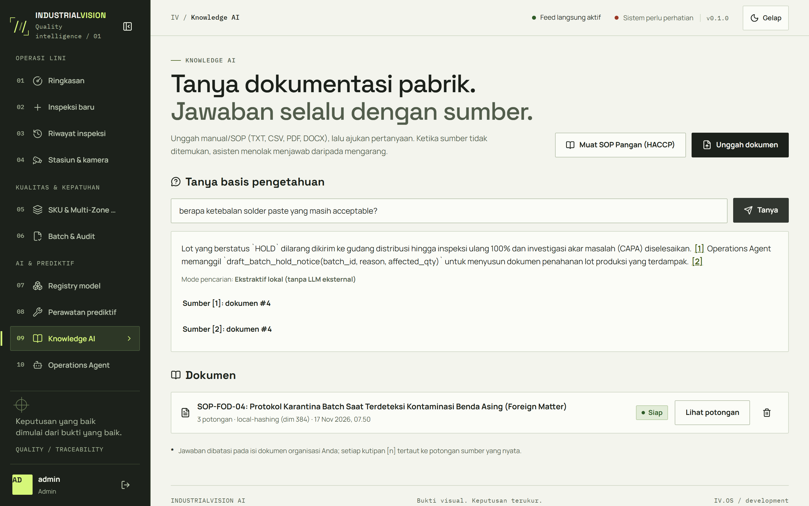 | 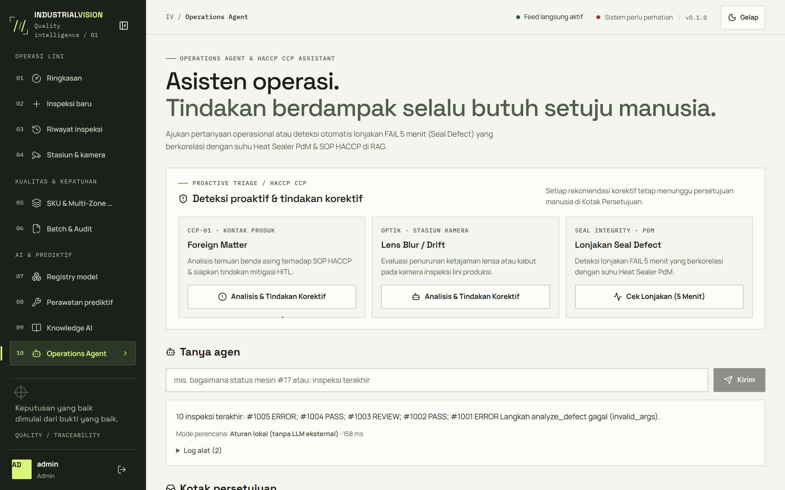 |

### MLOps monitoring & ML laboratory

Service health (bus/worker modes), model stages, and a browser-only RL
simulator explicitly labeled as educational:

| Monitoring | ML Lab |
|---|---|
| 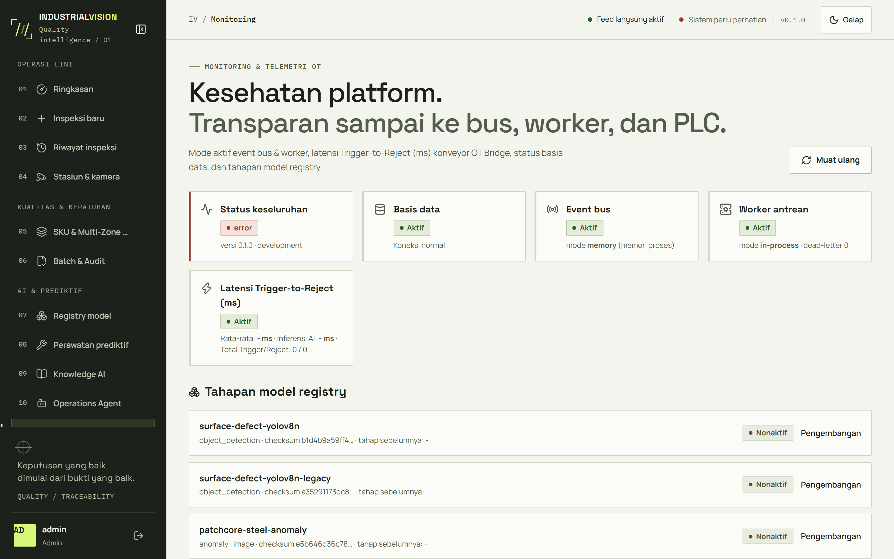 | 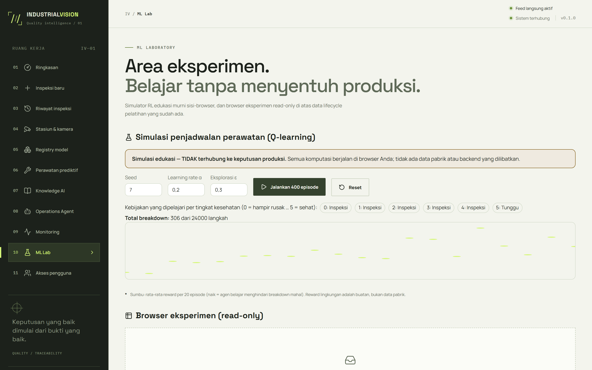 |

### Administration & responsiveness

| User administration | Responsive at 390 px |
|---|---|
| 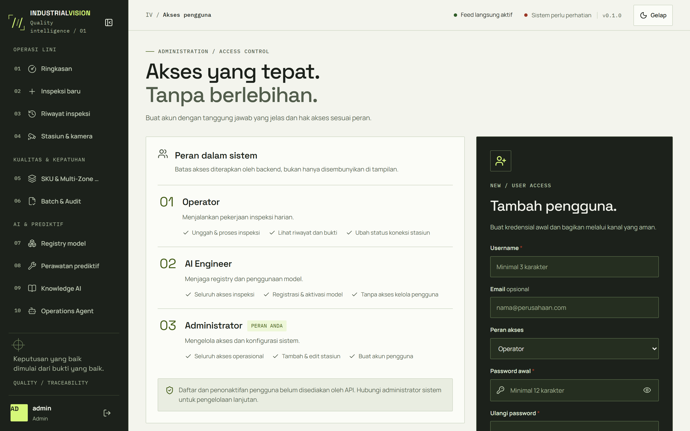 | 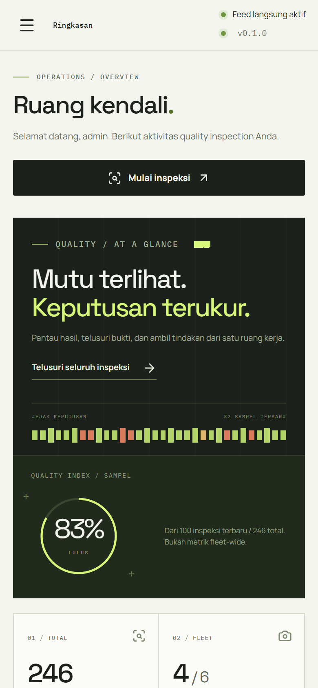 |

---

## Core Features

- **Industrial Operator Console (Anti-AI Slop UI):**
  A strong, industrial interface using a graphite palette (`#1c211b`), warm off-white (`#f3f4ed`), and signal lime (`#d6f779`). Includes locally bundled typography (*Space Grotesk*, *Manrope*, *IBM Plex Mono*) and a clear operational layout designed for production environments.
- **Image Inspection Workflow & Visual Evidence:**
  Upload sample product images (JPEG, PNG, WebP up to 100 MB). Quality decisions (`PASS`, `FAIL`, `REVIEW`, `ERROR`) are generated alongside numerical inference latency, decision rationale, and detection overlays.
- **Secure Evidence Storage:**
  Evidence images are stored with server-side path validation to prevent path traversal attacks. Retrieval of visual evidence via `GET /inspections/{id}/evidence` requires a valid JWT token and is isolated from direct public access.
- **AI Model Registry & Management:**
  Version tracking for AI models (ONNX, YOLO), task type registration (object detection, image anomaly, anomaly segmentation), defect classes, confidence thresholds, automatic SHA-256 checksum validation of server artefacts, and activation/deactivation controls.
- **Inspection Station Management (Fleet):**
  Registration of workstations with flexible sources (*browser upload*, RTSP, USB webcam, local file, simulation) and automatic redaction of RTSP credentials in stored URLs.
- **Role-Based Access Control (RBAC):**
  Strict separation of permissions at both the API and web interface layers:
  - `admin`: full configuration, station setup, user account management.
  - `ai_engineer`: full operational access, model registration, activation/evaluation.
  - `operator`: daily inspection execution, evidence review, operational status changes for stations.
- **Accessibility & Mobile Standards:**
  Passes automated **WCAG 2.1 AA** compliance checks (text contrast, keyboard focus, native modal focus containment) and adaptive mobile layout on 390 px viewports without horizontal overflow.
- **Predictive Maintenance (Phase B):** machines + AI4I-schema sensor readings, fail-safe
  predictions (model / rules-only-fallback / error modes), approval-gated maintenance requests,
  training pipelines that reuse the run lifecycle and model registry (validation-selected among
  3 candidates, held-out test metrics only).
- **Knowledge AI / RAG (Phase C):** hardened document ingestion on the worker queue, hybrid
  BM25+vector retrieval with RRF fusion, grounded answers with 1:1 citation enforcement and
  prompt-injection sanitization; empty retrieval refuses to answer instead of fabricating.
- **Operations Agent (Phase D):** org-scoped tools with execution-time RBAC, bounded state graph
  (iteration caps, per-tool timeouts), and persisted human-in-the-loop approvals — side effects
  execute only with an owner/admin approver's identity.
- **MLOps (Phase E):** model stage lifecycle (development/staging/production with an evaluation
  gate and one-production rule), PSI drift detection against training-time reference stats,
  optional MLflow mirroring, Monitoring page.
- **Scaling foundation (Phase A):** Redis pub/sub event bus with explicit in-memory fallback,
  RQ worker service with dead-letter handling, Prometheus + Grafana with provisioned dashboards
  and alert rules, checksum-verified backups with retention, multi-tenancy (organizations +
  org_id everywhere).

---

## System Architecture

The platform follows a **Modular Monolith** pattern with clear separation between domain logic, hardware/model adapters, and presentation layers:

```text
[ Camera / File / Browser Upload ]
                 │
                 ▼
[ Fastify / Starlette Proxy (Vite Dev / Nginx Production) ]
                 │
                 ▼
[ FastAPI Application Core (Python 3.13) ]
  ├── Auth & RBAC (PyJWT, Password Hashing)
  ├── Security Hardening (Upload Bounds, Path Sanitization, Secret Redaction)
  ├── Camera Service & Capture Worker (Bounding Deque, RTSP Redaction)
  ├── Inference & Anomaly Engine (ONNX Runtime, NumPy Adapters)
  ├── Decision Engine (Rules-based Evaluation: PASS / FAIL / REVIEW / ERROR)
  ├── Predictive Maintenance (pdm/: dataset mirror, training, fail-safe inference)
  ├── Knowledge AI (rag/: hybrid retrieval, grounded answers, citation enforcement)
  ├── Operations Agent (agent/: tools, bounded graph, HITL approvals)
  ├── MLOps (model stages, PSI drift, optional MLflow mirror)
  ├── Event Bus (in-memory ⇄ Redis pub/sub, /health-visible) & Task Queue (RQ + in-process)
  └── Evidence Storage (Server-rooted, Collision-safe UUIDs)
                 │
        ┌────────┴────────┐
        ▼                 ▼
[ SQLite / PostgreSQL ] [ File Storage (data/evidence) ]
        ▲
        │
[ React 19 Frontend Console (SPA + TailwindCSS Tokens) ]
  ├── AuthProvider & Route Guards (useRequireRole)
  ├── Operations Overview & Quality Index Gauge
  ├── Inspection Workbench & Precision SVG Detection Canvas
  ├── Filterable Traceability History & JSON Data Export
  └── Stations Fleet & Model Registry Consoles
```

---

## Technology Stack

### Backend & AI Runtime
- **Language & Framework:** Python 3.13+, FastAPI, Starlette, Uvicorn
- **ORM & Migrations:** SQLAlchemy 2.0 (Synchronous Engine), Alembic
- **Computer Vision & Inference:** OpenCV Headless, Pillow, NumPy, ONNX Runtime, ONNX
- **Security & Authentication:** PyJWT, Passlib (Argon2 / BCrypt)

### Frontend Console
- **Framework:** React 19, TypeScript 5.8+, Vite 8
- **Routing & State:** React Router 7, Context API, custom hooks (`useAuth`, `useApi`, `useToast`)
- **Design & Icons:** Custom CSS tokens, Tailwind CSS v4, Lucide React
- **Typography:** `@fontsource-variable/space-grotesk`, `@fontsource-variable/manrope`, `@fontsource/ibm-plex-mono`
- **Automated Testing:** Playwright, `@axe-core/playwright`

### Infrastructure & Deployment
- **Containerization:** Docker multi-stage builds, Docker Compose
- **Production Web Server:** Nginx unprivileged (`nginxinc/nginx-unprivileged:alpine-slim`)
- **Production Database:** PostgreSQL 16 Alpine

---

## System Requirements

Before starting, ensure your environment includes:

- **Python:** Version 3.11 to 3.13 (recommended 3.13)
- **Node.js:** Version 20.x or 22.x LTS (with `npm` 10+)
- **Git:** Latest version
- **Docker & Docker Compose:** *(Optional, if you want container-based deployment)*
- **OS:** Windows 10/11, macOS, or Linux (Ubuntu 22.04+)

---

## Application Startup Guide (Local Development)

### 1. Clone & Install Dependencies

```bash
# Clone the repository
git clone https://github.com/user/industrialvision-ai-platform.git
cd industrialvision-ai-platform

# Install Python backend dependencies
python -m pip install --upgrade pip
python -m pip install -r backend/requirements.txt

# Install React frontend dependencies
npm --prefix frontend install
```

### 2. Environment Configuration

Copy the sample configuration files to the project root and frontend directory:

```bash
# Main backend environment
cp .env.example .env

# Frontend environment
cp frontend/.env.example frontend/.env
```

For local testing, the default values in `.env.example` (SQLite at `./industrialvision_ai.db`) are ready to use immediately.

### 3. Database Migration & Admin Bootstrap

Run the database schema migration and create your first administrator account:

```bash
cd backend

# Apply Alembic database migrations
alembic upgrade head

# Create the first admin (this only applies if the database has no admin yet)
python -m app.cli create-admin --username admin_factory
```

The system will prompt for a password interactively (minimum 12 characters required).

> **Important Note About Admin Accounts:**  
> The command `python -m app.cli create-admin` can only be run once during initial installation. If the database already contains an admin, additional user creation (operators, engineers, or admin accounts) must be performed through the web UI or admin user-management API.

#### Populate Demo Data (Optional, Recommended for Demos/Development)

To fill the database with a complete, realistic dummy dataset — demo accounts, production lines, inspection stations, the AI model registry with evaluation history, hundreds of inspection records with synthetic evidence images, system events, and audit logs — run:

```bash
python -m app.seed --reset --confirm-reset WIPE-ALL-DATA
```

`--reset` deletes every table — including user accounts — so it requires the explicit typed
confirmation shown above, and the whole command refuses to run under `APP_ENV=production`.

This also activates the **live feed**: a backend background task generates a new inspection every few seconds for simulated stations, so the dashboard ticks in real time (marked by the **LIVE** indicator in the web console). Additional flags:

```bash
python -m app.seed --append                # add inspections without wiping data
python -m app.seed --reset --confirm-reset WIPE-ALL-DATA --inspections 500 --hours 168
python -m app.seed --reset --confirm-reset WIPE-ALL-DATA --no-evidence   # skips images (faster)
```

**Demo accounts created by the seeder:**

| Username | Password | Role |
| --- | --- | --- |
| `admin` | `Admin!Vision2026` | admin |
| `operator1` | `Operator!2026` | operator |
| `aiengineer` | `Engineer!2026` | ai_engineer |

> ⚠️ These demo credentials are for development environments only. Disable the live feed with `DEMO_LIVE_FEED=false` and replace all demo accounts before using the system anywhere else.

### 4. Running the Backend API

From the `backend` folder:

```bash
python -m uvicorn app.main:app --host 127.0.0.1 --port 8000 --reload
```

The backend is available at:
- **API Base:** [http://127.0.0.1:8000](http://127.0.0.1:8000)
- **Interactive Swagger Documentation:** [http://127.0.0.1:8000/api/docs](http://127.0.0.1:8000/api/docs)
- **OpenAPI JSON:** [http://127.0.0.1:8000/api/openapi.json](http://127.0.0.1:8000/api/openapi.json)

### 5. Running the Frontend Console

Open a new terminal in the project root:

```bash
cd frontend
npm run dev
```

Open your browser at [http://127.0.0.1:5173](http://127.0.0.1:5173).

> **Vite Proxy Flow:**  
> The frontend is configured with a `/api/v1` proxy edge that forwards requests to the backend on port `8000`. This prevents conflicts with the SPA routing layer and keeps frontend routes like `/camera` and `/models` isolated from backend APIs.

---

## Operational Workflow

After logging in, follow these steps to start inspections:

1. **Log In to the Control Room:**  
   Open `/login` and sign in using your administrator credentials.
2. **Register a Workstation:**  
   Open the **Stations & Cameras** menu (`/cameras`), click **Add station**, assign a name (for example `Line 01 - Visual Stamping`), and choose the source type **Upload image**.
3. **Register Model Artefacts:**  
   Open the **Model registry** page (`/models`). Ensure the ONNX model file is located in the `backend/models/` folder. Enter the filename (for example `detector.onnx`), define the defect classes, output format configuration, and activation settings.
4. **Run a Sample Inspection:**  
   Open the **New inspection** page (`/inspections/new`), select the station and active model, then upload a product component image. The system performs inference, stores the original evidence, and displays the bounding boxes and decisions.
5. **Audit the Quality Trace:**  
   Open the **Inspection history** page (`/inspections`) to view decision logs, filter by outcome or batch, and export the audit trail as JSON.

---

## Project Structure

```text
industrialvision-ai-platform/
├── .github/workflows/          # CI/CD GitHub Actions (lint, test, build, compose audit)
├── backend/                    # Core API, domain services, and computer vision engine
│   ├── app/
│   │   ├── api/v1/             # REST API routers (auth, cameras, inspections, models, admin)
│   │   ├── core/               # Pydantic configuration, security, logging sanitization, constants
│   │   ├── db/                 # SQLAlchemy models, session factory, base metadata
│   │   ├── schemas/            # Pydantic request/response validation schemas
│   │   ├── services/           # Business logic: decision engine, evidence storage, camera worker
│   │   └── vision/             # Inference adapters (ONNX Runtime, YOLO, PatchCore/PaDiM)
│   ├── migrations/             # Alembic migration environment
│   ├── tests/                  # 235 unit and integration tests using unittest
│   ├── alembic.ini             # Database migration configuration
│   ├── docker-entrypoint.sh    # Runs `alembic upgrade head` before serving traffic
│   ├── seed.py                 # Demo dataset seeder (blocked under APP_ENV=production)
│   ├── Dockerfile              # Multi-stage backend container build (non-root appuser)
│   └── requirements.txt        # Unified Python dependencies
├── frontend/                   # Operator console web app
│   ├── public/                 # Favicon and static assets
│   ├── src/
│   │   ├── api/                # HTTP client with JWT bearer interceptor and silent refresh
│   │   ├── components/         # UI components: Brand, EvidenceImage, InspectionTable, Modal, etc.
│   │   ├── hooks/              # Custom hooks: useAuth, useApi, useToast, useLiveFeed
│   │   ├── layouts/            # AppShell with industrial navigation and mobile drawer
│   │   ├── pages/              # Pages: Overview, NewInspection, History, Cameras, Models, Admin
│   │   ├── styles/             # Design system modules: app.css, pages.css, responsive.css
│   │   ├── types/              # Unified TypeScript declarations
│   │   ├── utils/              # Data formatters and multilingual error parsers
│   │   ├── App.tsx             # Routing and role-based route guards
│   │   ├── index.css           # Color tokens, typography, and CSS variables
│   │   └── main.tsx            # React 19 entry point
│   ├── nginx.conf              # TLS edge: HTTPS, security headers, rate limits, redacted logs
│   ├── iv-proxy-headers.inc    # Shared proxy header set for API and WebSocket routes
│   ├── Dockerfile              # Multi-stage Nginx build
│   └── package.json            # React, TypeScript, and Vite dependencies
├── scripts/backup.sh           # pg_dump backup and restore automation
├── deploy/tls/                 # TLS certificates (server.crt / server.key, not committed)
├── docs/                       # Architecture, dataset, operations, TLS, and release gate documents
├── docker-compose.yml          # Multi-container orchestration (PostgreSQL, Backend, Frontend)
├── .env.example                # Environment variable template
└── README.md                   # Project technical documentation
```

---

## REST & WebSocket API Reference

All business endpoints require the `Authorization: Bearer <token_jwt>` header unless they are public endpoints.

| Module | Method | Endpoint | Role Access | Description |
|---|---|---|---|---|
| **System** | `GET` | `/health` | Public | Server status, version, database connection, and active stations. |
| **Auth** | `POST` | `/auth/login` | Public | Username/password authentication; returns a JWT token. |
| **Auth** | `GET` | `/auth/me` | All Roles | Current logged-in user profile and access permissions. |
| **Auth** | `POST` | `/auth/logout` | Public | Client-side session invalidation (stateless). |
| **Cameras** | `GET` | `/cameras` | All Roles | List of all inspection workstations. |
| **Cameras** | `POST` | `/cameras` | `admin` | Register a new inspection workstation. |
| **Cameras** | `GET` | `/cameras/{id}` | All Roles | Detailed workstation information and specifications. |
| **Cameras** | `PUT` | `/cameras/{id}` | `admin` | Update name, resolution, FPS, or station status. |
| **Cameras** | `DELETE` | `/cameras/{id}` | `admin` | Remove a workstation from the system. |
| **Cameras** | `POST` | `/cameras/{id}/start` | `admin`, `operator` | Set workstation status to `connected`. |
| **Cameras** | `POST` | `/cameras/{id}/stop` | `admin`, `operator` | Set workstation status to `disconnected`. |
| **Inspections** | `POST` | `/inspections/image` | All Roles | Upload a sample image multipart and run inference. |
| **Inspections** | `GET` | `/inspections` | All Roles | Paginated inspection history with decision and batch filters. |
| **Inspections** | `GET` | `/inspections/{id}` | All Roles | Detailed result, latency, decision rationale, and defect findings. |
| **Inspections** | `GET` | `/inspections/{id}/evidence` | All Roles | Retrieve original evidence image securely (blob). |
| **Models** | `GET` | `/models/` | All Roles | Catalog of registered AI models filtered by task type. |
| **Models** | `POST` | `/models/` | `admin`, `ai_engineer` | Register model artefact metadata on the server. |
| **Models** | `POST` | `/models/{id}/activate` | `admin`, `ai_engineer` | Activate a model for active inference. |
| **Models** | `POST` | `/models/{id}/deactivate` | `admin`, `ai_engineer` | Deactivate a model from the inference queue. |
| **Models** | `GET` | `/models/{id}/evaluations` | All Roles | Evaluation performance history of the model. |
| **Admin** | `POST` | `/admin/users` | `admin` | Create a new operator or engineer account. |
| **Stream** | `WS` | `/ws/cameras/{id}/stream` | Valid JWT | Stream realtime camera metadata events. |
| **Stream** | `WS` | `/ws/inspections/live` | Valid JWT | Live feed of all inspection decisions (event bus). |

#### `WS /ws/inspections/live` Message Format

Authenticate with the `Sec-WebSocket-Protocol` header — the JWT never appears in the URL:

```js
const socket = new WebSocket('wss://host/ws/inspections/live', [`bearer.${accessToken}`])
```

Messages sent by the server:

```jsonc
// When the connection is accepted
{"type": "connected", "timestamp": 1769515200.1}
// Every time an inspection decision is stored (real pipeline or demo live feed)
{"type": "inspection.created", "inspection": {"id": 243, "decision": "PASS", "camera_id": 4, "detections": [], "anomaly": {"score": 0.21}, "latency_ms": 87.3, "timestamp": "2026-10-27T00:41:31.136064", "...": "..."}}
// Periodic heartbeat while there are no events
{"type": "heartbeat", "timestamp": 1769515215.1}
```

A `?token=<jwt>` query parameter is still accepted for backwards compatibility, but it is discouraged because reverse-proxy and browser-history logs can capture URLs. Nginx in this project redacts the query string from access logs regardless.

The web console subscribes to this feed through `LiveFeedProvider`: the Overview, History, and Stations pages update their data live without a reload, marked by the **LIVE** indicator.

#### Session Lifecycle (`/auth/login`, `/auth/refresh`, `/auth/logout`)

Access tokens are short-lived (15 minutes). A **refresh token** keeps operators signed in across a full shift (12 hours by default):

- `POST /auth/login` returns both `token.access_token` and `refresh_token`.
- `POST /auth/refresh` exchanges a refresh token for a new access token **and a new refresh token** (rotation). Reusing an already-rotated token is rejected.
- `POST /auth/logout` revokes every active refresh token for that user.
- The web client refreshes automatically on the first `401`; parallel requests wait for one refresh instead of triggering several. If the refresh fails, the user is returned to the login screen.

---

## Environment Variables

| Variable | Description | Default / Example | Required in Production? |
|---|---|---|:---:|
| `APP_ENV` | Application environment mode (`development` / `production`). | `development` | Yes |
| `DEBUG` | Enables debug logging and SQL query echoing. | `false` | Yes (must be `false`) |
| `HOST` | Uvicorn bind host address. | `127.0.0.1` | Yes |
| `PORT` | Backend server port. | `8000` | Yes |
| `DATABASE_URL` | SQLAlchemy synchronous database URL. | `sqlite:///./industrialvision_ai.db` | Yes (must be PostgreSQL in production) |
| `JWT_SECRET` | Secret key for JWT hashing (minimum 32 characters). | `dev-only-insecure-secret...` | Yes (must be random and unique) |
| `ACCESS_TOKEN_EXPIRE_MINUTES` | JWT session lifetime in minutes. | `15` | Yes |
| `REFRESH_TOKEN_EXPIRE_HOURS` | Shift-scoped refresh token lifetime; rotated on every use. | `12` | Yes |
| `LOGIN_MAX_FAILURES` | Failed logins per account before temporary lockout. | `5` | Yes |
| `LOGIN_LOCKOUT_MINUTES` | Lockout window for repeated login failures. | `15` | Yes |
| `TRUST_PROXY_HEADERS` | Honour `X-Forwarded-For`/`-Proto` (set `true` behind the Nginx edge). | `false` | Yes (`true` in Docker) |
| `CORS_ORIGINS` | Comma-separated list of allowed browser origins. | `http://localhost:5173,http://localhost:3000` | Yes (no wildcard `*`) |
| `MAX_UPLOAD_BYTES` | Max allowed image file size in bytes. | `104857600` (100 MB) | Optional |
| `EVIDENCE_ROOT` | Physical storage directory for visual evidence. | `data/evidence` | Optional |
| `MODEL_ROOT` | Storage directory for model artefacts. | `models` | Optional |
| `DEMO_LIVE_FEED` | Enables realtime simulated inspections for `simulated` stations (automatically disabled when `APP_ENV=test`; **refused at startup when `APP_ENV=production`**). | `true` | Must be `false` |
| `DEMO_FEED_INTERVAL_SECONDS` | Delay between inspections generated by the live feed. | `6` | Optional |

Frontend variables (`frontend/.env` file):

| Variable | Description | Default |
|---|---|---|
| `VITE_API_BASE_URL` | REST API base URL. | `/api/v1` (via Vite proxy) |
| `VITE_WS_URL` | Base URL of the live WebSocket feed. | Browser protocol & host (`ws(s)://location.host`) |

---

## Testing & Quality Verification

This project uses strict validation before code can be merged or released:

```bash
# 1. Run the 235 backend unit and integration tests
cd backend
python -m unittest discover -s tests -v

# 2. Verify Python code compilation
python -m compileall -q app migrations tests

# 3. Run the frontend linter (Oxlint)
npm --prefix frontend run lint

# 4. Type-check TypeScript and build the production frontend
npm --prefix frontend run build
```

Latest verification results:
- **Backend:** 235 tests passing (0 failed, 0 errors).
- **Frontend build:** Production bundle compiles cleanly without type errors.
- **Accessibility:** 0 WCAG 2.1 AA violations across the main routes.
- **Responsiveness:** 0 horizontal overflow on 390 px mobile viewport tests.

---

## Docker Compose Deployment

Runs an isolated production stack: PostgreSQL 18, a non-root backend, and an unprivileged Nginx edge that terminates TLS.

```bash
# 1. Provide secrets and TLS certificates
export JWT_SECRET="production-secret-key-minimum-thirty-two-characters"
export POSTGRES_PASSWORD="StrongPostgresPassword2026!"
# Place server.crt and server.key in deploy/tls/ (see docs/deployment-tls.md)

# 2. Build and run the full stack
docker compose up -d --build

# 3. Check container status
docker compose ps
```

Services are available at:
- **Frontend Console (HTTPS):** `https://<host>:8443`
- **HTTP:** port `8080` only redirects to HTTPS.
- **Backend Internal:** `http://backend:8000` (reachable through the Nginx proxy only)
- **Database:** PostgreSQL is isolated on the internal Docker network and publishes no host port.

### Startup behaviour

- `APP_ENV=production` is enforced; the container refuses to start if `JWT_SECRET` is weak,
  `DEMO_LIVE_FEED` is enabled, `LOG_LEVEL=DEBUG`, or `DATABASE_URL` is not PostgreSQL.
- The backend entrypoint runs `alembic upgrade head` before serving traffic and exits if
  migrations fail, so the schema can never lag behind the code.
- Override the public ports with `PUBLIC_HTTPS_PORT` / `PUBLIC_HTTP_PORT`, and the certificate
  directory with `TLS_CERT_DIR`.

### Backup & Restore

`scripts/backup.sh` takes a consistent `pg_dump` (custom format, gzip) plus a JSON manifest:

```bash
# Back up (reads POSTGRES_* from the environment or repo .env)
./scripts/backup.sh backup --output-dir /mnt/backup-nas

# Restore into the configured database
./scripts/restore.sh restore --backup-file /mnt/backup-nas/2026-10-27T04-21-13Z.dump.gz
```

Evidence images live in the `industrialvision_evidence_data` volume; back that up separately
(e.g. `docker run --rm -v industrialvision_evidence_data:/data -v /mnt/backup:/backup alpine tar czf /backup/evidence.tgz -C /data .`).
A restore is not complete until the database **and** the evidence volume are both restored.

---

## Troubleshooting

### 1. `An administrator already exists; use the admin user-management API`
The command `python -m app.cli create-admin` is only valid when creating the first administrator while the database is still empty. If your local database already contains an admin, log in through the web interface and use the user management flow instead.

### 2. API Status Shows "System requires attention" / Database Degraded
Make sure the SQLite database is accessible or that the PostgreSQL service is running. Health checks can be validated directly via:

```bash
curl http://127.0.0.1:8000/health
```

A normal response looks like: `{"status": "ok", "database": "ok", ...}`.

### 3. Inspection Evidence Image Does Not Display in the Browser
Ensure the `data/evidence/` directory has read/write permissions for the user running the backend process. The visual evidence endpoint requires a valid bearer token.

### 4. Bounding Boxes Are Misaligned
SVG bounding boxes are calculated using the image's natural dimensions and then aligned proportionally to the rendered image container. Ensure the image is not being distorted or resized with an incorrect aspect ratio during display.

---

## Security & System Limitations

### Implemented controls

- **Transport security:** TLS 1.2/1.3 terminated at the Nginx edge, HSTS enabled, HTTP redirected to HTTPS. The backend port binds to `127.0.0.1` only.
- **Credential transport:** REST uses `Authorization: Bearer`; WebSockets use the `Sec-WebSocket-Protocol: bearer.<jwt>` header so tokens never appear in URLs. Nginx access logs omit the query string.
- **Browser hardening:** `Content-Security-Policy` restricted to same-origin resources (fonts are bundled; no inline scripts), plus `X-Content-Type-Options`, `X-Frame-Options`, `Referrer-Policy`, and `Permissions-Policy`.
- **Authentication:** per-account lockout after repeated failures, per-IP `limit_req` on `/api/v1/auth/login`, and an `AuditLog` entry for every login success, login failure, and logout.
- **Session management:** 15-minute access tokens with rotating 12-hour refresh tokens stored as SHA-256 hashes; logout revokes all of a user's refresh tokens.
- **Demo-data protection:** `python -m app.seed` refuses to run under `APP_ENV=production`; `--reset` additionally requires `--confirm-reset WIPE-ALL-DATA`; the fabricated live feed is refused at startup in production.
- **Credential sanitization:** RTSP camera URLs are sanitized to remove username/password before storage or display.
- **Path traversal prevention:** model and evidence paths are validated against `MODEL_ROOT` / `EVIDENCE_ROOT`; `..` and absolute paths are rejected.
- **Least privilege:** containers run as non-root users, drop all Linux capabilities, and use `no-new-privileges`; nginx runtime paths are mounted as tmpfs.

### Verified by test

377 backend tests (unittest) cover the vision core plus the PdM/RAG/agent/MLOps/lab modules,
multi-tenancy isolation, worker/queue behavior (RQ via fakeredis), the Redis event bus (fake
transport), cookie/CSRF mode matrix, and checksum-verified backups. The frontend typecheck/build
and the axe/390px sweep run over all routes, including a PostgreSQL 18 CI job that applies every
migration and runs the suite against a real database. The Compose stack itself was executed on
the authoring workstation (see PLANNING.md Phase H for the recorded smoke output).

### Known limitations

- **Model validation:** activating a model only marks the artefact as available for inference; it does not certify defect-detection accuracy. Threshold calibration against your own defect set is still required.
- **Direct video streaming:** the browser path is authenticated MJPEG over fetch (no tokens in URLs) with client-side overlay composition from WS events — it is NOT WebRTC; expect ~0.5–2 s LAN latency rather than sub-second glass-to-glass.
- **Synthetic PdM data:** the predictive-maintenance training set is a documented synthetic mirror of AI4I 2020 (or a real CSV you provide at `PDM_DATASET_CSV`); no real fleet data has been used, and all reported metrics come only from completed runs recorded in their manifests.
- **LLM providers without keys:** answers and agent planning run in labeled `mock-demo` mode (deterministic, extractive, local) until `OPENAI_API_KEY`/`GEMINI_API_KEY` are configured; the active provider is always visible in API responses and the UI.
- **pgvector:** vector similarity uses the pgvector SQL path when the extension exists on PostgreSQL and a bounded in-memory numpy scan otherwise (`/rag/storage` reports the active backend); no HNSW index is created yet, so very large chunk counts are O(n) per query.
- **Chat rate limiting** is per-process; add an nginx `limit_req` (or Redis-backed limiter) in front of multi-replica deployments.
- **Optional OCR** requires the tesseract binary; without it the service reports `unavailable-missing-tesseract` instead of pretending.
- **PostgreSQL migration coverage:** the nine migrations are verified on SQLite here and exercised on PostgreSQL in CI; the pgvector extension itself is optional (see above).
- **Token storage in the browser:** access and refresh tokens are kept in `sessionStorage`, or in `localStorage` when "remember me" is checked. The strict same-origin CSP (no inline or third-party scripts) mitigates the usual XSS vector, but httpOnly cookies would be stronger. Treat this as a hardening item if your threat model includes hostile extensions on operator workstations.
- **Evidence backup is manual:** `scripts/backup.sh` covers the database only; the evidence volume must be archived separately.
- **Docker images are not built in this environment:** the compose stack was reviewed and its config validated, but a full `docker compose up` has not been executed on this machine.

---

## License & Contribution

This project is licensed under the terms of an internal / proprietary license. All code contributions must comply with quality review standards, pass the full unit-test suite, and maintain traceability for production safety and operational reliability.

---

---

## User Guide (Panduan Lengkap)

Panduan penggunaan lengkap dalam Bahasa Indonesia — termasuk akun demo untuk
stack Docker yang berjalan, tur setiap halaman, alur end-to-end 5 menit, demo
data lengkap mode pengembangan, dan troubleshooting cepat:

**[docs/USER_GUIDE.md](docs/USER_GUIDE.md)**

Akun demo stack produksi lokal: `smokeadmin / SmokeAdmin!2026` (admin) ·
`smokeowner / SmokeOwner!2026` (owner) · `ui_operator / isolated-ui-password-2026`
(operator) — aplikasi: **https://localhost:8443**
